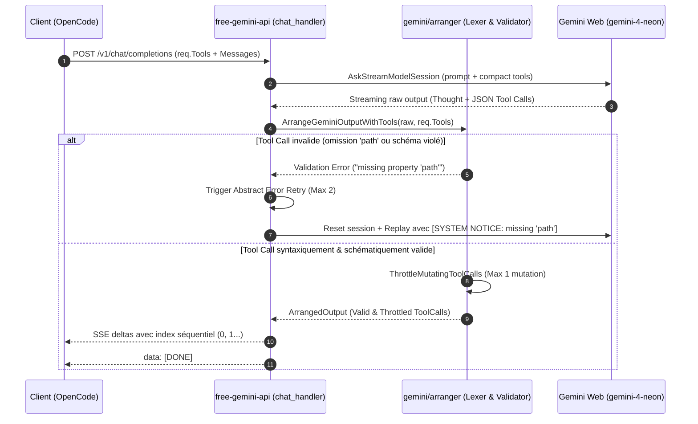

# Plan d'Implémentation — Fiabilisation Middleware Agentique (Phase 2 : Schémas & Méga-Tours)

## Description de l'objectif

À la suite du succès de la **Phase 1 (v3.4.5)** qui a immunisé le proxy contre les corruptions de fichiers (*mid-value truncation*), les décalages d'offset UTF-8 et la non-conformité SSE, ce plan formalise la **Phase 2** de la feuille de route établie dans [`docs/recherches/Prompt-Engineering-vs-Middleware-Agentique.md`](file:///home/kidpixel/free-gemini-api-main/docs/recherches/Prompt-Engineering-vs-Middleware-Agentique.md).

L'objectif de la Phase 2 est de doter `free-gemini-api` d'un **contrôle déterministe absolu sur les arguments d'outils et la cadence d'écriture** :
1. **Validation formelle JSON Schema (Draft 2020-12 / Draft-07)** en pur Go via `github.com/santhosh-tekuri/jsonschema/v6` : vérifier mécaniquement la présence de tous les champs requis (`path`, `command`, `content`, `old_string`, `new_string`) et la conformité des types avant qu'aucun appel n'atteigne OpenCode ou l'hôte.
2. **Plafonneur de mutations (*Write-Serial Throttling*)** : limiter mécaniquement chaque tour d'agent à **une seule mutation de fichier** (`write`, `edit`, `patch`, `shell` modificateur), tout en autorisant les lectures parallèles (`read`, `grep`, `glob`), empêchant ainsi l'effondrement d'attention sur les méga-tours de 10 outils.
3. **Protocole de retry par abstraction d'erreur** : en cas d'invalidation de schéma ou d'omission de clé (ex. omission de `path`), réinitialiser la conversation amont empoisonnée et relancer avec une directive synthétique ciblée (`[SYSTEM NOTICE: tool 'write' omitted required property 'path'...]`) sans recopier les tokens bruts cassés.
4. **Compaction du catalogue d'outils (`FormatToolsInstruction`)** : compacter et ordonner l'injection des schémas d'outils pour réduire l'empreinte de prompt de 40 à 60 % et éliminer l'effet *lost in the middle*.

---

## Revue Utilisateur Requise

> [!IMPORTANT]
> **Ajout de dépendance Go pure (`github.com/santhosh-tekuri/jsonschema/v6`)** :
> Cette bibliothèque est la référence standard en Go pour JSON Schema (Draft 2020-12, Draft 7, Draft 4). Elle est **100 % Go pur (aucun CGO)**, compatible avec Alpine et Go 1.26, et n'ajoute qu'une dépendance transitive légère déjà satisfaite (`golang.org/x/text`). Aucun impact sur la portabilité du binaire ni sur la toolchain.

> [!IMPORTANT]
> **Comportement du Plafonneur de Mutation (*Write-Serial*)** :
> Si un modèle génère dans un même tour 2 ou 3 outils d'écriture consécutifs (par exemple `write(file1)` puis `write(file2)`), le proxy :
> - Conserve l'intégralité des lectures parallèles (`read`, `glob`, `grep`) qui précèdent.
> - Conserve **uniquement la première mutation**.
> - Coupe le tour à cet endroit et émet `finish_reason: "tool_calls"`.
> OpenCode exécute alors la première mutation et renvoie son résultat au modèle, qui peut ensuite émettre la seconde mutation au tour suivant de manière séquentielle et vérifiée.

---

## Architecture & Flux d'Exécution



---

## Modifications Proposées

### Dépendances (`go.mod`)

#### [MODIFY] `free-gemini-api/go.mod`
- Ajout de `github.com/santhosh-tekuri/jsonschema/v6 v6.0.3`.

---

### Composant 1 : Validateur JSON Schema & Cache LRU (`gemini/`)

#### [NEW] `free-gemini-api/gemini/schema_validator.go`
- Définition de `ToolSchemaRegistry` :
  - Cache en mémoire thread-safe (`sync.RWMutex`) associant le hash SHA-256 du bloc d'outils au catalogue de schémas compilés `map[string]*jsonschema.Schema`.
  - Méthode `CompileTools(tools []map[string]any) (*CompiledToolCatalog, error)`.
  - Méthode `ValidateCall(name string, argsJSON string) (bool, string)` :
    - Vérifie que `name` existe dans le catalogue.
    - Désérialise `argsJSON` en `any`.
    - Exécute `schema.Validate(argsObj)` et renvoie `(true, "")` si valide, ou `(false, errDetail)` avec le message précis (ex: `"missing property 'path'"` ou `"type mismatch for 'command'"`).
- Fonction helper `HasInvalidSchemaToolCall(raw string, tools []map[string]any) (bool, string)` pour déclencher les retries en amont.

#### [NEW] `free-gemini-api/gemini/schema_validator_test.go`
- Tests unitaires complets :
  - Validation réussie sur schémas OpenCode typiques (`write`, `read`, `edit`, `shell`).
  - Rejet immédiat sur clé manquante (`missing required property 'path'`).
  - Rejet immédiat sur type invalide (`path: 123` au lieu d'une chaîne).
  - Rejet d'un outil non déclaré dans `req.Tools`.
  - Vérification de la performance et de la concurrence du cache de compilation.

---

### Composant 2 : Intégration Arranger & Plafonneur de Mutation (`gemini/`)

#### [MODIFY] `free-gemini-api/gemini/arranger.go`
1. **Signature étendue & Rétrocompatibilité** :
   ```go
   // ArrangeGeminiOutputWithTools analyse, nettoie et valide strictement les sorties contre req.Tools
   func ArrangeGeminiOutputWithTools(raw string, tools []map[string]any) *ArrangedOutput
   
   // ArrangeGeminiOutput conserve sa signature pour compatibilité ascendante
   func ArrangeGeminiOutput(raw string) *ArrangedOutput {
       return ArrangeGeminiOutputWithTools(raw, nil)
   }
   ```
2. **Validation des appels extraits** :
   - Dans `extractTaggedToolCalls` et `findFirstJSONToolCall`, si `tools != nil`, chaque appel est validé via `schema_validator`. Les appels non conformes sont rejetés (déclenchant le repli ou l'invalidation).
3. **Plafonneur d'écriture (*Write Throttling*)** :
   - Implémentation de `ThrottleMutatingToolCalls(calls []ToolCall) []ToolCall` :
     - Parcourt les appels dans l'ordre.
     - Conserve toutes les lectures (`read`, `grep`, `glob`, `list`).
     - Autorise la **première** mutation (`write`, `edit`, `shell`, `patch`).
     - Dès qu'une seconde mutation est rencontrée, arrête le lot à ce niveau.
4. **Compaction des schémas d'outils (`FormatToolsInstruction`)** :
   - Remplacer le `json.MarshalIndent` volumineux par une sérialisation compacte :
     - Extraction ciblée des champs clés : `name`, `description` (tronquée si verbeuse), `parameters.properties` et `parameters.required`.
     - Mise en avant explicite de `required` et ordonnancement forcé de `path` en première clé de chaque schéma.

#### [MODIFY] `free-gemini-api/gemini/arranger_test.go`
- Ajout de tests pour :
  - `TestArrangeGeminiOutputWithTools_ValidSchema`
  - `TestArrangeGeminiOutputWithTools_MissingPathRejected`
  - `TestThrottleMutatingToolCalls_SingleWriteAllowed`
  - `TestThrottleMutatingToolCalls_ParallelReadsWithOneWrite`
  - `TestFormatToolsInstruction_CompactOutput`

---

### Composant 3 : Gestionnaire de Chat & Retry par Abstraction d'Erreur (`api/`)

#### [MODIFY] `free-gemini-api/api/chat_handler.go`
1. **Appel de l'Arranger avec les outils de la requête** :
   - Ligne 673 (Streaming) : `arranged := gemini.ArrangeGeminiOutputWithTools(rawOutput, req.Tools)`.
   - Ligne 916 (Non-streaming) : `arranged := gemini.ArrangeGeminiOutputWithTools(resp.Text, req.Tools)`.
2. **Plafonnement des mutations** :
   - Application de `gemini.ThrottleMutatingToolCalls(arranged.ToolCalls)` avant l'émission des deltas SSE et de la réponse JSON.
3. **Retry par Abstraction d'Erreur** :
   - Si la validation schématique échoue sur la première tentative :
     - Au lieu de réinjecter un prompt neutre ou de répéter l'erreur, formater une directive de rattrapage abstraite :
       `[SYSTEM DIRECTIVE: Previous tool call failed validation: <détail_erreur>. Re-issue the tool call correcting this parameter with 'path' placed first.]`
     - Réinitialiser la session amont et rejouer le tour avec cette directive.

#### [MODIFY] `free-gemini-api/api/session_transcripts.go`
- Mettre à jour `isUnusableModelOutput` pour accepter optionnellement `tools []map[string]any` ou ajouter `isSchemaInvalidOutput(text string, tools []map[string]any) bool`.

---

### Composant 4 : Documentation & Journal des Modifications

#### [MODIFY] `CHANGELOG.md`
- Ajout de la section `[3.4.6]` documentant la validation JSON Schema, le plafonneur de mutations et la compaction des prompts d'outils.

#### [NEW] `docs/plans/plan_fiabilisation_phase_2.md`
- Copie de sauvegarde du présent plan dans l'arborescence du dépôt.

---

## Plan de Vérification

### 1. Tests Unitaires & Couverture
```bash
./scripts/audit_check.sh
```
Critères de succès :
- `gofmt` : 100 % propre.
- `go vet` : 0 alerte.
- Tests `api`, `db`, `gemini` : Tous passants.
- Couverture `gemini` maintenue ≥ 70 %.

### 2. Tests de Concurrence sous Docker
```bash
docker run --rm -e CGO_ENABLED=1 -v $(pwd)/free-gemini-api:/app -w /app golang:1.26 go test -race -short ./...
```
Critères de succès :
- 0 data race sur le cache LRU de schémas compilés et sur le plafonneur.

### 3. Tests Dédiés Phase 2
```bash
docker run --rm -v $(pwd)/free-gemini-api:/app -w /app golang:1.26-alpine go test -v ./gemini -run "TestSchemaValidator|TestThrottleMutatingToolCalls|TestArrangeGeminiOutputWithTools"
```
