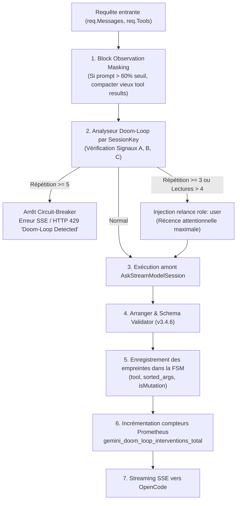

# Plan d'Implémentation — Fiabilisation Middleware Agentique (Phase 3 : Passerelle d'État, Doom-Loops & Context-Engineering)

## Description de l'objectif

Après la fiabilisation du transport et des écritures (**Phase 1 / v3.4.5**) et la validation formelle des schémas JSON avec plafonnement d'écriture (*Write-Serial*, **Phase 2 / v3.4.6**), ce plan formalise la **Phase 3** issue de [`docs/recherches/Prompt-Engineering-vs-Middleware-Agentique.md`](file:///home/kidpixel/free-gemini-api-main/docs/recherches/Prompt-Engineering-vs-Middleware-Agentique.md).

Cette phase constitue le **dernier palier de fiabilisation requis pour l'usage local** (la Phase 4 relevant d'un banc d'évaluation CI continu). Son objectif est de doter le proxy d'une **passerelle d'état intelligente (*Stateful Gateway*)** capable de :
1. **Rompre mécaniquement les *Doom-Loops*** : intercepter les répétitions rotatives d'appels (cycles A/B/A/B), les enlisements dans l'inspection passive (> 4 lectures consécutives sans mutation) et les séries d'échecs.
2. **Alléger la mémoire vive du contexte (*Block Observation Masking*)** : compacter par blocs les anciens retours volumineux d'outils (anciens logs de compilation, lectures antérieures) dès que la fenêtre de contexte grossit, levant la *Context Anxiety* du modèle sans briser le cache de préfixe.
3. **Dynamiser les relances en `role: user`** : injecter à récence maximale (dernier message utilisateur) les rappels anti-boucle pour forcer le modèle à agir plutôt qu'à relire indéfiniment.
4. **Exposer les métriques agentiques Prometheus (`/metrics`)** : mesurer en temps réel les interventions anti-boucles, les retries et les rejets de schémas.

---

## Revue Utilisateur Requise

> [!IMPORTANT]
> **Seuils d'intervention du Détecteur de *Doom-Loops*** :
> - **Signal A (Répétition d'appel identique ou cycle A/B/A/B)** :
>   - À **3 répétitions** : injection d'une directive anti-boucle dans le prompt pour forcer un changement d'action.
>   - À **5 répétitions identiques consécutives** : **coupure nette (*circuit breaker*)** avec émission d'une erreur explicite `[Error: doom-loop detected: identical tool call repeated 5 times]` pour éviter de brûler les tokens et figer l'agent.
> - **Signal B (Passivité en reprise)** :
>   - Si l'agent effectue **plus de 4 lectures d'affilée** (`read`, `glob`, `grep`, `list`) sans aucune écriture (`write`, `edit`), le proxy injecte une relance `role: user` :  
>     `"Tu as déjà inspecté les fichiers [A, B, C]. Interdiction de relire ces fichiers. Émets immédiatement l'appel d'outil d'écriture (write ou edit) pour appliquer le changement prévu."`

> [!IMPORTANT]
> **Règle de compactage (*Block Observation Masking*)** :
> - Les **4 derniers tours** de la conversation sont toujours conservés **intacts à 100 %**.
> - Dès que le prompt total dépasse **60 % de `maxPromptBytes`** (~600 Ko) ou plus de 15 tours, les résultats d'outils plus anciens (> 4 tours) dont le corps dépasse 200 caractères sont compactés : leurs 3 premières lignes sont conservées, suivies d'une mention `... [compacted: N bytes omitted; re-read if needed]`.
> - Cela permet de réduire la taille du prompt de 50 à 75 % lors des replays tout en préservant le contexte sémantique.

---

## Architecture & Flux d'Exécution



---

## Modifications Proposées

### Composant 1 : Détecteur de *Doom-Loops* (`api/`)

#### [NEW] `free-gemini-api/api/doom_loop.go`
- Définition de `DoomLoopTracker` :
  - `sync.Mutex` pour accès concurrentiel sûr par session.
  - Historique borné des N dernières empreintes d'appels `canonicalCallFingerprint(name, argsJSON)`.
  - Compteur de lectures consécutives sans mutation (`consecutiveReads`).
  - Compteur de répétitions du même appel consécutif (`repeatCount`).
  - Détection de cycles alternés A/B/A/B ou A/B/C/A/B/C (`detectCycle()`).
- Méthodes principales :
  - `RecordToolCall(name, argsJSON string, isMutation bool)` : met à jour les compteurs et l'historique d'empreintes.
  - `CheckIntervention() (action string, detail string)` :
    - `ActionHalt` (si 5 répétitions identiques).
    - `ActionWarnRepeat` (si 3 répétitions ou cycle A/B/A/B).
    - `ActionWarnPassiveRead` (si > 4 lectures consécutives sans écriture).
    - `ActionNone` (nominal).
  - `Reset()` : réinitialise l'état lors d'un changement de tâche explicite.

#### [NEW] `free-gemini-api/api/doom_loop_test.go`
- Tests unitaires complets :
  - Répétition identique d'outil (alerte à 3, arrêt à 5).
  - Cycle rotatif A/B/A/B détecté.
  - Détection d'enlisement en lecture passive (> 4 lectures consécutives).
  - Réinitialisation du compteur dès qu'une mutation (`write`/`edit`) est effectuée.
  - Sécurité des accès concurrents (`sync.Mutex`).

---

### Composant 2 : Gestion de Contexte & *Observation Masking* (`api/`)

#### [NEW] `free-gemini-api/api/observation_masker.go`
- Fonction `MaskOldToolObservations(messages []OpenAIChatMessage, maxRecentKept int, sizeThresholdBytes int) []OpenAIChatMessage` :
  - Calcule la taille totale estimée des messages.
  - Si la taille dépasse `sizeThresholdBytes` (par défaut 600 Ko ou seuil configurable) :
    - Parcourt les messages chronologiquement en identifiant les rôles `tool` ou les blocs `[Tool Result]`.
    - Préserve intégralement les `maxRecentKept` derniers résultats (par défaut 4).
    - Pour les résultats antérieurs volumineux (> 200 octets), conserve l'en-tête (3 premières lignes) et remplace le reste par :  
      `\n... [compacted: %d bytes omitted; re-read if needed]\n`
  - Renvoie la liste allégée pour le flattening sans altérer l'objet d'origine.

#### [NEW] `free-gemini-api/api/observation_masker_test.go`
- Tests unitaires :
  - Transcript court (< seuil) : aucun masquage, conservation intégrale.
  - Transcript volumineux (> seuil) : masquage des vieux résultats, conservation des 4 derniers intacts.
  - Vérification de la validité UTF-8 et de la préservation du rôle `tool`.

---

### Composant 3 : Intégration dans le Pipeline de Chat (`api/`)

#### [MODIFY] `free-gemini-api/api/session_transcripts.go`
- Association d'une instance `*DoomLoopTracker` à chaque `sessionTurnEntry`.
- Exposition des fonctions d'accès thread-safe :
  - `getOrCreateSessionTracker(sessionKey string) *DoomLoopTracker`
  - `recordSessionToolCalls(sessionKey string, calls []gemini.ToolCall)`

#### [MODIFY] `free-gemini-api/api/chat_handler.go`
1. **Application du Masking lors du flattening** :
   - Avant `fullPromptBuilder.WriteString`, appliquer `MaskOldToolObservations` si la session accumule beaucoup de tours ou de volume.
2. **Intervention anti-boucle** :
   - Vérifier `tracker.CheckIntervention()` avant l'envoi :
     - Si `ActionHalt` : retourner immédiatement une erreur explicite (SSE error chunk ou HTTP 429/502).
     - Si `ActionWarnRepeat` ou `ActionWarnPassiveRead` : ajouter une directive de récence maximale en fin de prompt (ou via un message utilisateur synthétique) pour forcer le modèle à agir.
3. **Enregistrement des appels** :
   - Après parsing et validation par `ArrangeGeminiOutputWithTools`, enregistrer les appels retenus dans le tracker de session.

---

### Composant 4 : Observabilité & Métriques Prometheus (`api/`)

#### [MODIFY] `free-gemini-api/api/metrics.go`
- Déclaration de compteurs atomiques Prometheus :
  - `RecordDoomLoopIntervention(signal string)` : labels `signal="repeat"`, `signal="cycle"`, `signal="passive_read"`.
  - `RecordArrangerRepair(kind string)` : labels `kind="control_chars"`, `kind="brace_envelope"`, `kind="disclaimer"`.
  - `RecordArrangerRejection(reason string)` : labels `reason="mid_value_truncation"`, `reason="schema_invalid"`, `reason="undeclared_tool"`.
  - `RecordRefusalRetry()` : compte les réinitialisations transparentes de conversation sur faux refus.
- Ajout des métriques formatées dans `renderMetricsWithStats()`.

#### [MODIFY] `free-gemini-api/api/metrics_test.go`
- Validation de l'exposition correcte des nouvelles métriques dans la sortie `/metrics`.

---

### Composant 5 : Documentation & Versioning

#### [MODIFY] `CHANGELOG.md`
- Documentation de la version `[3.4.7]`.

#### [NEW] `docs/plans/plan_fiabilisation_phase_3.md`
- Copie de sauvegarde du présent plan dans l'arborescence du dépôt.

---

## Plan de Vérification

### 1. Tests Unitaires & Couverture Complète
```bash
./scripts/audit_check.sh
```
Critères de succès :
- `gofmt` : 100 % propre.
- `go vet` : 0 alerte.
- Tests `api`, `db`, `gemini` : Tous passants.
- Couverture globale et par package maintenue au-dessus des exigences.

### 2. Détection de Concurrence de Données
```bash
docker run --rm -e CGO_ENABLED=1 -v $(pwd)/free-gemini-api:/app -w /app golang:1.26 go test -race -short ./...
```
Critères de succès :
- 0 data race sur les compteurs Prometheus, les trackers de session et l'analyseur de doom-loops.

### 3. Tests Dédiés Phase 3
```bash
docker run --rm -v $(pwd)/free-gemini-api:/app -w /app golang:1.26-alpine go test -v ./api -run "TestDoomLoop|TestObservationMasker|TestMetrics"
```
